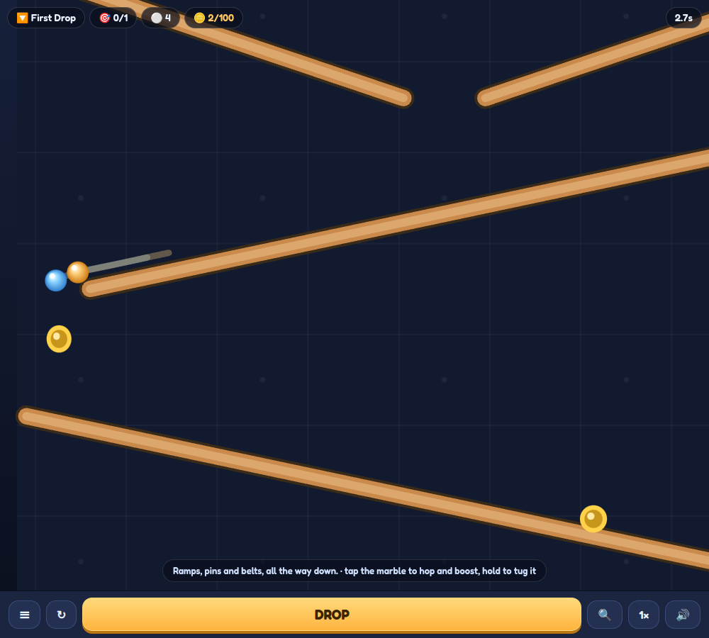

# Marble Machine

A marble-run browser game. Drop a marble at the top and follow it down a Rube Goldberg course around
twenty thousand pixels deep, through tubes, paddle wheels, seesaws, belts, cannons, pin fields, water
tanks and warps. There are eight courses with 100 coins on each.

**Play it:** https://brepre109.github.io/marble-machine/



## Features
- Eight hand-assembled courses (First Drop, Switchback, Spin Cycle, Seesaw Street, Split Decision,
  The Cannon, Water Works, The Machine). A run takes between 100 and 390 seconds.
- The camera follows the marble. 🔍 zooms out to show the whole machine, and the speed button cycles
  through 1×, 2×, 4× and ½×.
- **Tap the marble** to make it hop and speed up, which is how you reach coins that hang above the
  running line. **Hold and drag** to pull it toward the pointer.
- Coins are generated along each marble's own traced path, so every coin can be reached.
- All sound is synthesised with Web Audio. There are no audio files.
- Touch-first layout that also works with a mouse and keyboard (Space drops, R restarts, V zooms,
  S changes speed, Esc goes back).
- Progress, best coins and best time are saved in `localStorage`.

## Quick start
No build step and no dependencies. The only third-party code is a vendored copy of Matter.js.

```bash
git clone https://github.com/brepre109/marble-machine.git
cd marble-machine
python3 -m http.server 8000      # or: npm start
# open http://localhost:8000
```

Run the headless course test (Node 18+). It plays every course to its win condition:

```bash
npm test                 # all eight courses
node test/courses.test.js 0 3   # just courses 1 and 4
```

## How it works
| file | what it is |
| --- | --- |
| `index.html` | shell, course menu and HUD (plain CSS, no framework) |
| `levels.js` | parameterised course **modules** and the eight course recipes |
| `coins.js` | generated file: 100 coins per course, placed along the marble's traced path |
| `game.js` | physics setup, mechanisms, camera, canvas rendering, synthesised sound, input, test harness |
| `vendor/matter.min.js` | [Matter.js](https://brm.io/matter-js/) 0.20 (MIT) |
| `test/courses.test.js` | runs the real game files in Node behind a stubbed DOM and plays each course |

**Courses are built from modules.** `levels.js` contains modules for zigzag ramps, switchback tubes, pin
fields, bumpers, seesaw staircases, paddle wheels, belts, cannons, water tanks, warps and splitter levers.
Each module declares where it has to be fed (`entryX`) and returns its pieces, its height and where it
hands the marble on (`exitX`). The course builder puts a full-width catch funnel between each pair, so
any module can follow any other. The header of `levels.js` lists the geometry rules that the physics
tests forced. Examples: ramps need at least 12°, a paddle wheel's feed ramp has to end outside the blade
circle, and a 2D corkscrew can't work, so the game uses switchbacks.

**The test harness.** `window.__mm` in the browser (and the same object in Node) exposes
`sim(i)`, `simFull(i)` (feeds marbles until the course is won), `trace(i, sec, every)` (the marble's path
frame by frame, which is how the courses were laid out), `drawOnce(t)`, `step()`, `spawn()` and `hop(i, dx)`.
The physics runs at a fixed 60 Hz step, so a headless run follows the same code path as the browser.

## Tech stack
Vanilla JavaScript (ES2020), Canvas 2D, Web Audio, Matter.js. It is served as static files.

## Status / limitations
- Complete and playable on desktop and mobile. All eight courses finish in the headless test.
- The physics isn't bit-for-bit deterministic across browsers, so a marble can occasionally get stuck
  on a real device. Tap it to nudge it free.
- There is no level editor yet. New courses are written in `levels.js`, and `coins.js` has to be
  regenerated after any geometry change. The generator script isn't included in this repo.

## License
MIT © 2026 Brett Prejeant. `vendor/matter.min.js` is Matter.js by Liam Brummitt, under the MIT license.
